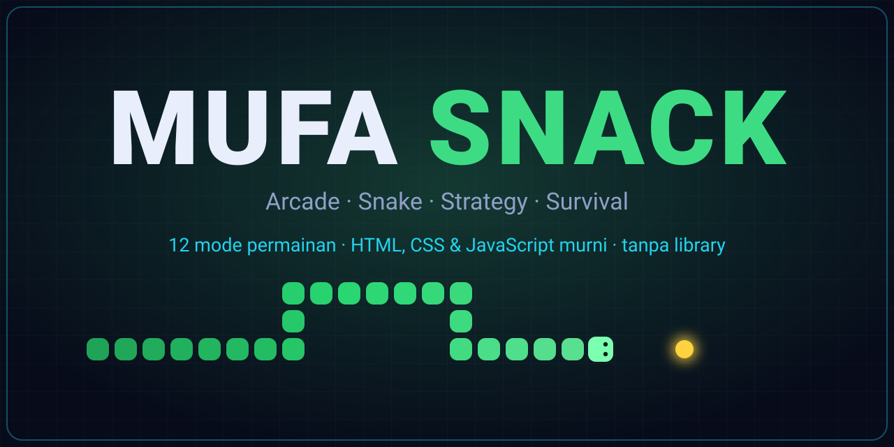
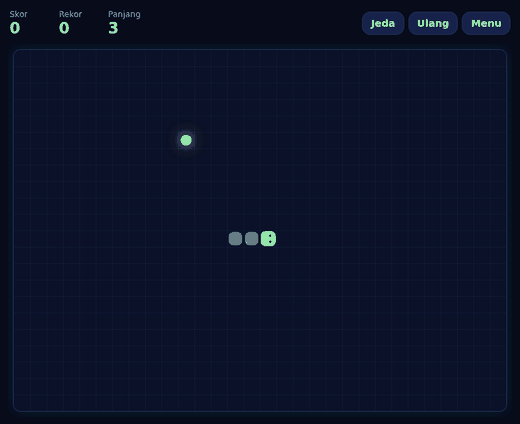
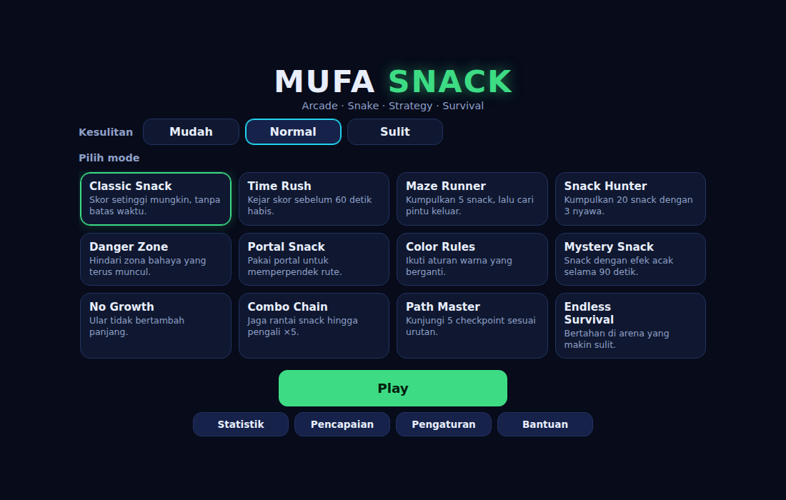
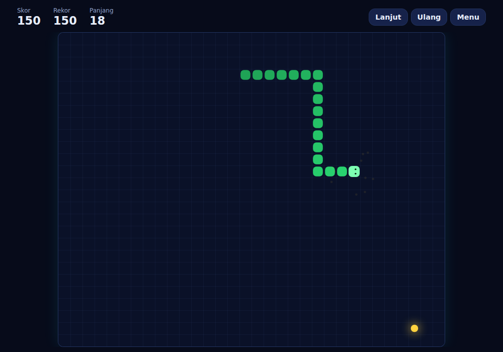

<p align="center">
  
</p>

<p align="center">
  <a href="https://faris-it.github.io/snake-game/"><b>▶ Main sekarang</b></a>
</p>

<p align="center">
  
  
  
  
  
  
</p>

**Mufa Snack** adalah game arcade ular dengan 12 mode yang aturannya benar-benar berbeda. Semuanya dibuat dengan
HTML, CSS, dan JavaScript murni: grafik digambar lewat kode, efek suara dibuat dengan Web Audio, dan tidak ada
framework, library, aset gambar, atau backend. Game 01 dari **Mufa Games**.

## Kenapa seru
- **12 mode, bukan satu game dengan 12 nama:** dari labirin, portal, zona bahaya, aturan warna yang berganti, sampai efek acak.
- **3 tingkat kesulitan** dengan rekor terpisah untuk setiap mode.
- **13 pencapaian** dan **tema** (Ocean, Sunset, Neon) yang terbuka lewat permainan.
- **Main di desktop maupun HP:** keyboard, geser layar, atau tombol arah virtual.
- **Ringan dan offline:** setelah dimuat, tidak ada permintaan jaringan; progres tersimpan di browser.

<p align="center">
  
</p>

## Tampilan
<p align="center">
  
  
</p>

## Menjalankan
Buka `index.html` di browser (klik dua kali sudah cukup), atau jalankan server statis lokal:

```
python3 -m http.server
```

lalu buka `http://localhost:8000`.

## Kontrol
- **Desktop:** Panah atau WASD untuk bergerak, Space untuk jeda/lanjut, Esc untuk menu jeda.
- **Mobile:** geser di area arena, atau pakai tombol arah di layar.
  Tombol arah muncul otomatis di perangkat sentuh dan bisa diatur di Pengaturan (Otomatis/Aktif/Mati).

## Mode permainan
| Mode | Aturan singkat |
|---|---|
| Classic Snack | Skor setinggi mungkin. Kecepatan naik tiap 5 snack. |
| Time Rush | 60 detik. Kecepatan naik tiap 10 detik. |
| Maze Runner | Kumpulkan 5 snack, masuk pintu keluar. 10 level, +50 poin per level. |
| Snack Hunter | Kumpulkan 20 snack dengan 3 nyawa. Snack bonus oranye (30 poin) tidak dihitung ke target. |
| Danger Zone | Zona merah berkedip 2 detik lalu aktif. 3 nyawa. |
| Portal Snack | 15 snack. Dua portal; tidak aktif jika titik keluar ditempati ular. |
| Color Rules | 15 snack. Hindari warna terlarang (bertanda X). Snack warna target +20. 3 nyawa. |
| Mystery Snack | 90 detik. Snack "?" memberi efek acak (bonus, memendek, perlambatan, perisai). |
| No Growth | Ular tidak bertambah panjang. Kecepatan naik tiap 10 snack. |
| Combo Chain | Snack berurutan dalam 5 detik menaikkan pengali hingga ×5. |
| Path Master | 5 checkpoint berurutan lalu pintu keluar. 10 level, 3 nyawa. |
| Endless Survival | Rintangan baru muncul seiring progres (dengan peringatan). |

Tiga tingkat kesulitan (Mudah, Normal, Sulit) mengubah kecepatan dan jumlah rintangan; skor tidak berubah.
Rekor disimpan terpisah untuk setiap mode dan kesulitan.

## Pencapaian dan tema
13 pencapaian tersedia di menu Pencapaian. Tema tambahan hanya mengubah tampilan:
- **Ocean:** makan 100 snack total (pencapaian Pemakan Snack)
- **Sunset:** menangkan mode apa pun (pencapaian Pemenang)
- **Neon:** mainkan semua 12 mode (pencapaian Penjelajah Mode)

## Penyimpanan
Pengaturan, statistik, pencapaian, dan rekor disimpan di `localStorage` pada browser dan perangkat yang dipakai
(kunci `mufa-snack:v1`). Menu Pengaturan memiliki tombol untuk menghapus semua data.

## Struktur proyek
```
index.html            halaman tunggal
css/                  reset, style (tema), menu, game, panel, responsive
js/config.js          konfigurasi arena, kecepatan, skor, tema, daftar mode
js/game-engine.js     siklus game, status, gerak, hook mode, helper untuk mode
js/collision.js       tabrakan dinding, tubuh sendiri, rintangan
js/scoring.js         skor dan kecepatan
js/renderer.js        gambar Canvas
js/input.js           keyboard, geser, tombol arah
js/storage.js         localStorage
js/achievements.js    daftar dan evaluasi pencapaian
js/audio.js           efek suara (Web Audio, tanpa file audio)
js/i18n.js            teks antarmuka
js/ui.js, main.js     menu, HUD, panel, inisialisasi
js/modes/*.js         aturan unik tiap mode
js/utils/*.js         grid, BFS, generator dinding, acak
tests/logic.test.js   uji logika tanpa browser
TESTING.md            checklist rilis
```

## Menambah mode
1. Buat `js/modes/nama-mode.js` yang memanggil `Mufa.defineMode({ id: '...', ... })`.
2. Tambahkan `<script>` file tersebut di `index.html` sebelum `js/ui.js`.
3. Pastikan `id` sama dengan yang ada di `js/config.js`; kartu mode otomatis aktif di menu.

Hook yang bisa ditimpa (semua opsional, bawaan ada di `game-engine.js`):
`onStart(s)`, `onTick(s, dt)`, `onMove(s, head)`, `onEat(s)` (boleh mengembalikan `end`/`title`),
`onItem(s, item)`, `onBeforeMove(s, next)`, `onFoodSpawn(s, food)`, `avoidCells(s)`,
`onCollision(s, type)`, `getObjective(s)`, serta `speedMs(s)` dan properti `grow`, `speedEvery`.
Helper engine untuk mode: `Mufa.engine.end()`, `resetSnake()`, `respawnFood()`, `occupied()`,
`clearZone()`, `hold()`, `loseLife(title, text)`.

## Menambah bahasa
Teks antarmuka (menu, HUD, panel) ada di `js/i18n.js`. Tambahkan bahasa dengan
`Mufa.i18n.register('en', 'English', { ...kunci yang sama... })`; pilihan bahasa muncul otomatis di Pengaturan.
Nama dan deskripsi mode ada di `js/config.js`, serta teks di dalam setiap file mode dan nama pencapaian di
`js/achievements.js`, jadi ikut diterjemahkan jika bahasa baru ditambahkan.

## Publikasi
Game ini statis, jadi cukup diunggah ke layanan hosting statis.

**GitHub Pages:** buat repository `mufa-snack`, unggah seluruh isi folder, lalu aktifkan Pages
(Settings → Pages → Deploy from a branch → `main` / root). Alamatnya berbentuk `https://<akun>.github.io/mufa-snack/`.

**Cloudflare Pages:** hubungkan repository, biarkan build command kosong, dan isi output directory dengan `/`.

Setelah URL aktif, tambahkan kartu Mufa Snack di katalog Mufa Games yang mengarah ke URL tersebut.
Memperbarui game cukup dengan mengunggah ulang file; website Mufa Games tidak perlu dibangun ulang.

## Pengujian
- `node tests/logic.test.js` menjalankan uji logika (arena, mode, nyawa, skor, penyimpanan).
- `TESTING.md` berisi checklist rilis yang perlu diuji manual di desktop dan mobile.

## Lisensi
Lihat `LICENSE`.
